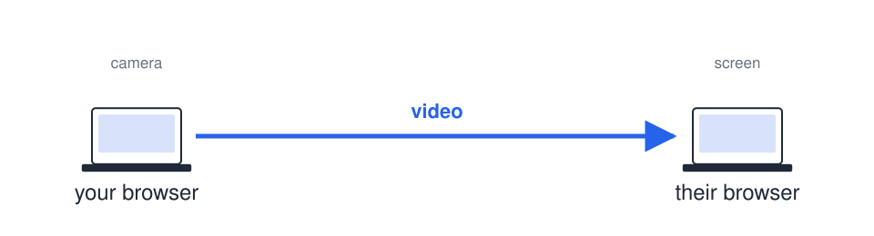
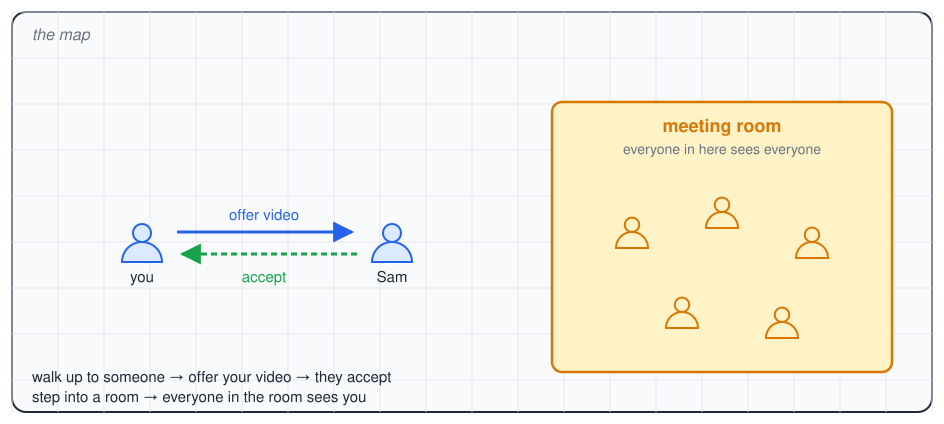
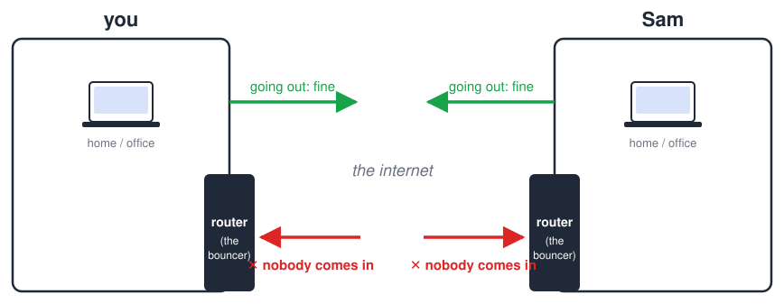
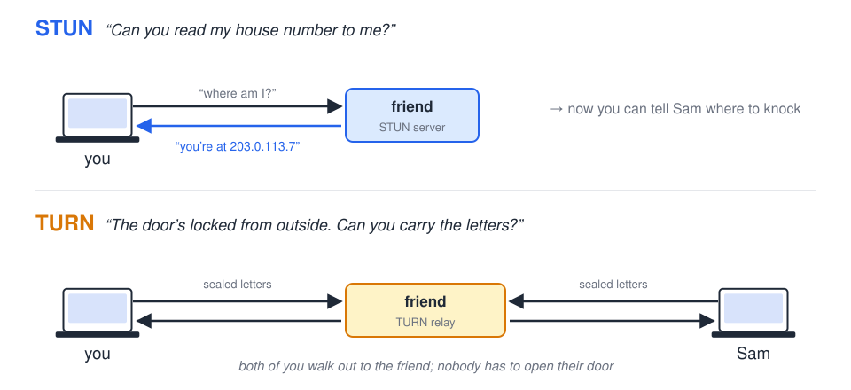
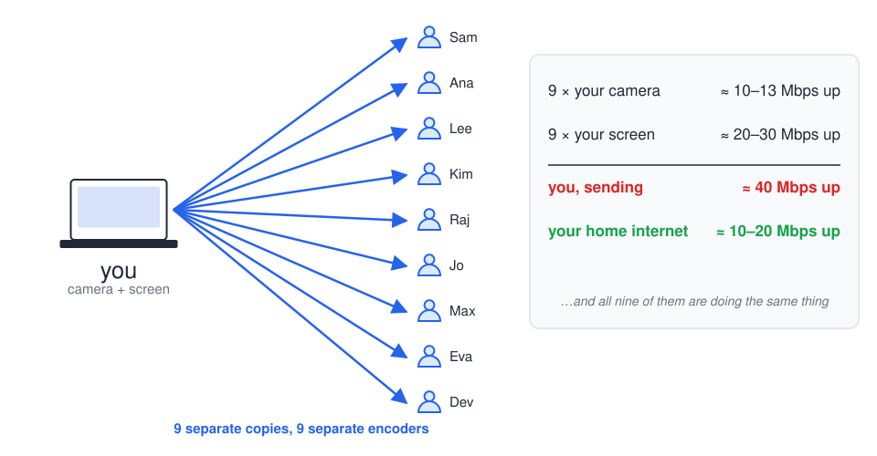
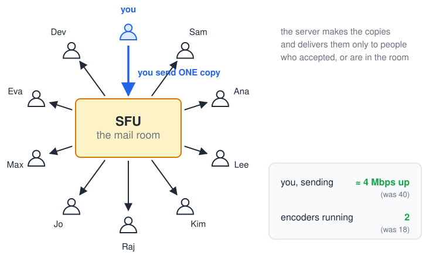
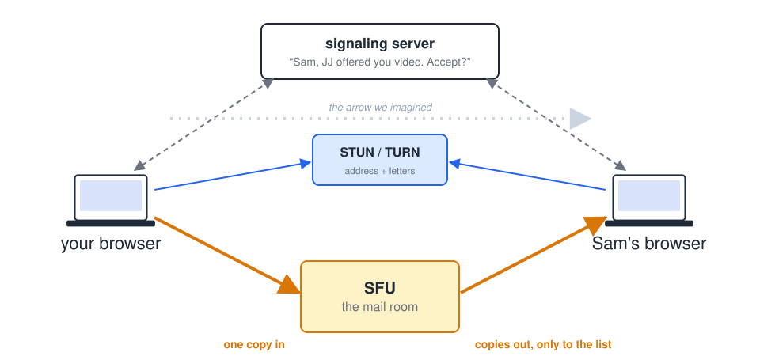

<style>
.fig { display: block; max-width: 92%; max-height: 60vh; margin: 0.6em auto; }
</style>

class: center, middle

# A five-minute tour of WebRTC
## Why a Video Call Needs a Third Computer


JJ Salley<br>
CSWG · November 5, 2026

???
Hi. Five minutes. One idea: a video call looks like two browsers talking to
each other, and it almost never is. I'm going to break that picture, piece by
piece, and show you what's actually standing in the middle.

---

## The simple picture



**One arrow. This is what we all imagine.**

???
This is the picture everyone has in their head. My camera, your screen, one
arrow between them. WebRTC is the browser technology that tries to make this
real. Hold on to this picture; I'm going to come back to it at the end and it
will look very different.

---

## Works on my machine



**I've been building this. On one laptop, it works.**

???
Quick peek at something I've been working on, with my boss's knowledge: a
Gather-style space for the team. There's a map. You walk up to someone and
offer your video, and they accept it, the same way you'd hand someone your
phone to show them a picture. Step into a room, and everyone in the room can
see you.

Right now this works perfectly, on my laptop, with two browser windows. The
rest of this talk is why it won't work on *your* laptop yet, and why that
isn't a bug.

---

## Your router is a bouncer



**Both of you are online. Neither of you can accept a knock at the door.**

???
Here's the first thing in the way. Almost everyone is behind a router: at
home, at the office, on your phone. A router is a bouncer. It happily lets
you out to the internet. It does not let strangers in. If a packet shows up
at your front door that you didn't ask for, the bouncer turns it away.

So picture two people, both online, both behind bouncers, both with their
arms crossed. Neither one can accept the other's call. Being online is not
the same as being reachable.

The technical name is NAT, if you want to look it up. The bouncer is all you
need.

---

## Two favors from a friend across the street



**STUN finds the address. TURN carries the mail when the door won't open.**

???
Two tricks, both of which involve a friend who lives out on the public
internet.

STUN: you don't actually know your own address as the world sees it; the
router hides it from you. So you ask a friend across the street to read your
house number to you. Now you can tell Sam where to knock, and surprisingly
often that's enough: the bouncer lets Sam's packet in because it looks like a
reply to something you sent out.

TURN: sometimes the bouncer is strict—office networks, mobile carriers—and
nothing gets in. So you ask the friend to carry the letters. You hand yours
out; Sam hands his out; the friend passes them back and forth. Nobody has to
accept a knock. The friend can't read the letters; they're sealed.

That's two servers already, and we've only got two people on the call.

---

## Now add eight more people



**Ten people in a room: everyone sends nine copies. The math does not work.**

???
This is the slide that matters. Put ten people in a room, everybody on
camera, half of them sharing a screen.

There's no such thing as sending a video to nine people at once. The internet
doesn't work that way. Your browser has to send nine separate copies, and run
nine separate video encoders to make them. Camera plus screen, nine times
over, is around 40 megabits a second going up. A typical home connection gives
you ten to twenty. Your laptop fan is screaming, and you're still a factor of
two short.

And here's the thing: TURN doesn't help. TURN carries letters; it doesn't make
fewer of them. It just relays the same nine copies.

So direct browser-to-browser video is fine for two people. By eight it has
fallen over. The thing I built on one laptop will do exactly this if I ship it
as is.

---

## The mail room



**Everyone sends once. The server copies and delivers. It's called an SFU.**

???
The fix is a mail room. Every browser sends one copy of its camera and one of
its screen to a server. The server makes the copies and delivers them. Your
upload drops from forty megabits to four. Your laptop runs two encoders instead
of eighteen.

The technical name is an SFU, a selective forwarding unit, and "selective" is
the word that matters for us. The mail room has a list. You offered Sam your
video and Sam accepted: Sam's on the list. You walked into the meeting room:
everyone in the room is on the list. The server only delivers to people on the
list. Who's on the list is still the app's decision, the same share-and-accept
rule you saw on the map. The server just enforces it.

This server is real software. It's the part I haven't built yet, and it's the
reason "works on my laptop" and "works for the team" are months apart, not
days.

---

## The real picture



**That's the distance between "one browser talks to another"<br>
and "a team can hang out in a room."**

???
So here's the picture from slide one, with everything that was hiding behind
the arrow.

A signaling server, so the two browsers can find each other and so the "do you
accept?" question has somewhere to live. STUN and TURN, so the bouncers don't
stop the call. And an SFU, the mail room, so ten people in a room doesn't need
forty megabits from each of them.

None of that is the part you see. All of it is the part that has to exist
before the part you see works for anyone but me. That's what I've been
learning, and that's what's next.

---

class: quick-reference

# Thank you.

## WebRTC quick reference

| | |
|---|---|
| **NAT** | your router is a bouncer |
| **signaling** | how browsers find each other and ask permission |
| **STUN** | “read me my house number” |
| **TURN** | “carry the letters, the door’s locked” |
| **mesh** | everyone sends to everyone — dies at eight |
| **SFU** | the mail room — send once, server delivers |

???
Thank you. I am happy to take questions.

---

class: center, middle

# Questions only — not part of the talk

## How would we get a TURN server and an SFU?

```text
   managed service                run it ourselves
   ───────────────                ─────────────────
   someone else's mail room       our own mail room
   pay per minute / per GB        pay in ops time
   up in an afternoon             full control, our bill

   (LiveKit, Daily, Twilio …)     (LiveKit, mediasoup, Jitsi, coturn …)
```

???
Only if someone asks. Both routes give you the same standard relay and
forwarding; the trade is whose pager goes off. Either way you need short-lived
credentials, because an open TURN server is free bandwidth for the whole
internet. I haven't picked yet.

---

class: center, middle

# Questions only — not part of the talk

## Can the server see my video?

```text
   TURN   sealed envelopes. It carries them; it can't open them.

   SFU    reads the address on the envelope to know where to send it.
          With a standard SFU, the honest answer is: it *could* open it.
          End-to-end encryption through an SFU exists, but it's extra work.
```

???
TURN relays encrypted packets and cannot decrypt them. An SFU has to read
packet headers to route, and in a standard setup it could decrypt the media.
There are ways to do end-to-end encryption through an SFU, but it's not the
default and it costs features. Don't overclaim in a short talk; "it could,
and here's what we'd do about it" is the honest line.

---

class: center, middle

# Questions only — not part of the talk

## Six words to remember

```text
   NAT         your router is a bouncer
   signaling   how browsers find each other and ask permission
   STUN        "read me my house number"
   TURN        "carry the letters, the door's locked"
   mesh        everyone sends to everyone — dies at eight
   SFU         the mail room — send once, server delivers
```

???
There's a one-page vocab sheet with the longer list if anyone wants it.
